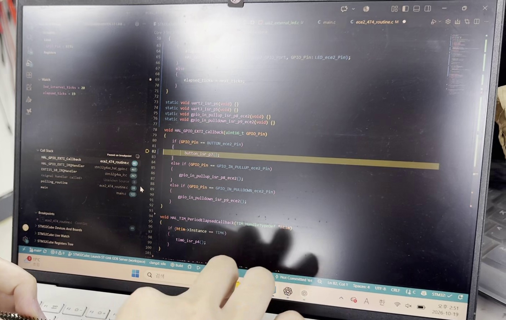
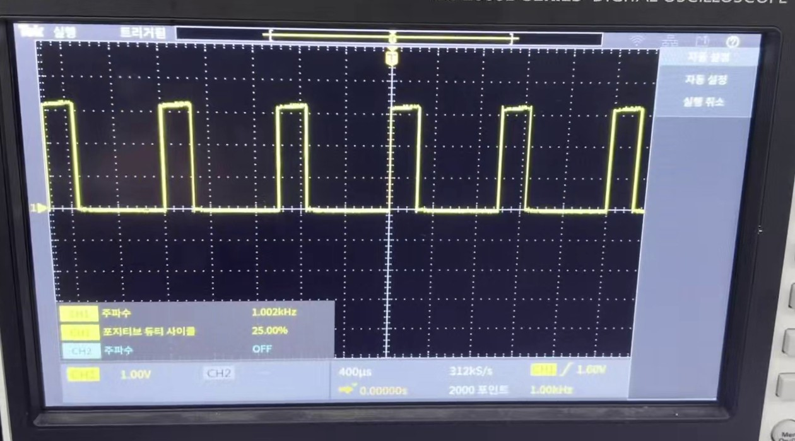

# 실험 후 레포트: STM32_1 과제3·과제4 (인터럽트와 PWM)

작성일 2026-10-21. 실험일 2026-10-19. 보드: NUCLEO-G474RE, 수업 프로젝트 [Glaysia/ece2_474](https://github.com/Glaysia/ece2_474) v1.1.0.

[과제 코드와 실행 방법](../../evidence/STM32_1/VScode/README.md) · [빌드 확인](../../evidence/STM32_1/VScode/build_check.txt)

## 1. STM32_1_과제3 · 버튼·TIM6 인터럽트로 LED 간격 변경

### 코드
[task3_isr_interval/ece2_474_routine.c](../../evidence/STM32_1/VScode/task3_isr_interval/ece2_474_routine.c)

- `ece2_474_init()`에서 `HAL_TIM_Base_Start_IT(&htim6)`로 TIM6(100 ms 주기) 인터럽트를 시작하고, `polling_routine()`은 비워 두었습니다.
- 두 ISR이 함께 쓰는 `led_interval_ticks`(간격, TIM6 호출 횟수 단위)와 `elapsed_ticks`(마지막 LED 변경 뒤 지난 호출 수)를 함수 밖에 `volatile`로 선언했습니다.
- `button_isr_p7()`: 200 ms 이내 재호출(접점 떨림)을 무시하고 `led_interval_ticks`를 10 → 20 → 40 → 80 → 10(1 → 2 → 4 → 8 → 1초)으로 바꿉니다.
- `tim6_isr_p4()`: 호출될 때마다 `elapsed_ticks`를 늘리고, `led_interval_ticks`에 도달하면 PA5 LED를 반전하고 0으로 되돌립니다.

### 보드 결과
[과제3 시연 영상](../../evidence/STM32_1/board/task3_demo.mp4) · [사진](../../evidence/STM32_1/board/photos/task3_board.jpg)

- 다운로드 직후 PA5 LED가 1초 간격으로 깜빡였고, USER 버튼(B1)을 누를 때마다 간격이 2초 → 4초 → 8초 → 1초로 바뀌었습니다. STM32_0_과제1(폴링)과 같은 동작을 메인 루프 없이 인터럽트만으로 재현했습니다.

### C 디버거로 확인
[디버거 시연 영상](../../evidence/STM32_1/board/task3_debug_demo.mp4) · [중단점에서 멈춘 화면](../../evidence/STM32_1/board/photos/task3_debug_breakpoint.jpg)

- `HAL_GPIO_EXTI_Callback()`의 `button_isr_p7();` 호출 줄에 중단점을 걸고 버튼을 누르자 CPU가 멈췄습니다. Call Stack에 `EXTI15_10_IRQHandler → HAL_GPIO_EXTI_IRQHandler → HAL_GPIO_EXTI_Callback`이 표시되어, 버튼 입력이 EXTI 인터럽트로 이 함수를 호출함을 확인했습니다.
- Watch 창에서 버튼을 누를 때마다 `led_interval_ticks`가 10 → 20 → 40 → 80 → 10으로 바뀌는 것을 확인했습니다. `elapsed_ticks`는 멈춘 순간 5, 19, 32 등 간격보다 작은 값으로 나타나 TIM6가 계속 횟수를 세고 있었음을 보여 줍니다.
- 실행 중(멈추지 않은 상태)에는 Watch 값이 `not available`로 표시되었습니다. 일반 Watch는 CPU가 멈췄을 때만 메모리를 읽기 때문입니다.

## 2. STM32_1_과제4 · 버튼으로 PWM 비율 변경

### 코드
[task4_pwm_button/ece2_474_routine.c](../../evidence/STM32_1/VScode/task4_pwm_button/ece2_474_routine.c)

- `ece2_474_init()`에서 `HAL_TIM_PWM_Start(&htim3, TIM_CHANNEL_1)`로 PB4 PWM을 시작하고 비교값 250(25%)을 설정했습니다. TIM3은 100 MHz ÷ 100 = 1 MHz로 세고 한 주기 1000칸이라 1 kHz이며, 비율 = 비교값 / 1000입니다.
- `button_isr_p7()`: 200 ms 떨림 무시 후 `pwm_percent`를 25 → 50 → 75 → 25로 바꾸고, `pwm_compare = pwm_percent × 10`을 `__HAL_TIM_SET_COMPARE`로 TIM3에 씁니다.

### 보드 결과 (Tektronix TBS2000B 오실로스코프, PB4–GND)
[과제4 시연 영상](../../evidence/STM32_1/board/task4_demo.mp4)

| 버튼 누름 | 기대 비율 | 측정 주파수 | 측정 포지티브 듀티 | 사진 |
|---|---:|---:|---:|---|
| 시작 | 25% | 1.002 kHz | 25.00% | [25%](../../evidence/STM32_1/board/photos/task4_pwm_25.jpg) |
| 1번 | 50% | 1.002 kHz | 49.99% | [50%](../../evidence/STM32_1/board/photos/task4_pwm_50.jpg) |
| 2번 | 75% | 1.002 kHz | 74.99% | [75%](../../evidence/STM32_1/board/photos/task4_pwm_75.jpg) |
| 3번 | 25% | 1.005 kHz | 25.00% | [다시 25%](../../evidence/STM32_1/board/photos/task4_pwm_25_again.jpg) |

- 버튼을 누를 때마다 듀티가 25 → 50 → 75 → 25%로 순환했고, 측정값과 설정값의 차이는 0.01%p 이내였습니다.
- 측정 주파수가 1.000 kHz가 아니라 1.002~1.005 kHz인 것은 보드의 클록이 내부 HSI(16 MHz RC 발진기)를 PLL로 체배한 것이라 수정 발진기보다 오차가 크고, 오실로스코프 주파수 측정에도 오차가 있기 때문으로 보입니다. 오차는 0.5% 이내입니다.

## 3. 결론

과제3에서는 STM32_0의 폴링 코드를 버튼 EXTI 인터럽트와 TIM6 주기 인터럽트로 바꾸어 같은 LED 간격 변경 동작을 구현했고, 디버거의 중단점·Call Stack·Watch로 인터럽트 호출 경로와 공유 변수의 변화를 직접 확인했습니다. 과제4에서는 TIM3 PWM의 비교값을 버튼 ISR에서 바꾸어 1 kHz PWM의 듀티를 25/50/75%로 순환시켰고, 오실로스코프 측정값이 설정값과 0.01%p 이내로 일치했습니다.
