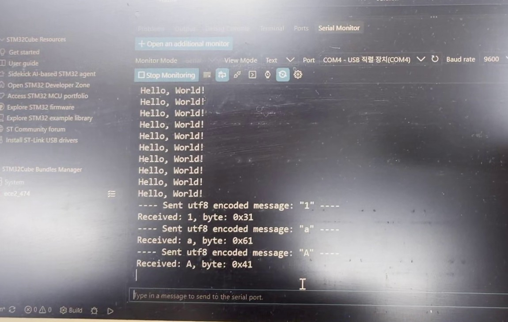
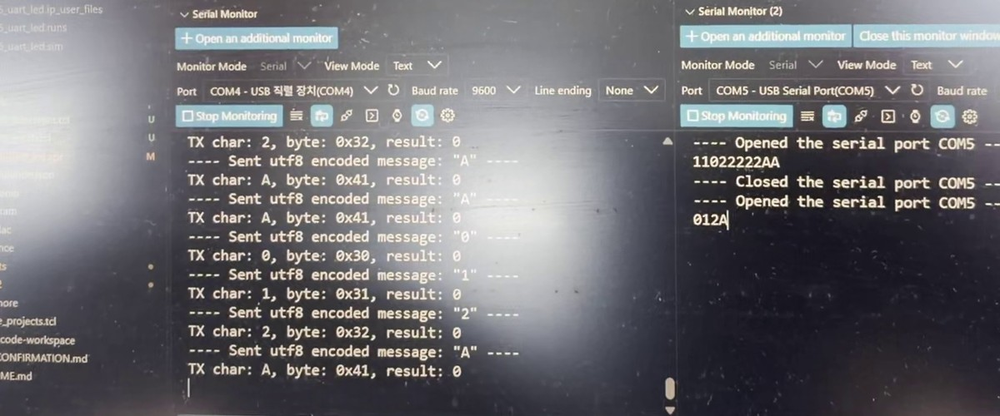

# 실험 후 레포트: STM32_2 과제5·6·7 (컴퓨터와 FPGA UART 통신)

작성일 2026-11-01. 실험일 2026-10-26. 보드: NUCLEO-G474RE + Combo II-DLD S75, 수업 프로젝트 [Glaysia/ece2_474](https://github.com/Glaysia/ece2_474) v1.1.0.

[과제 코드와 실행 방법](../../evidence/STM32_2/VScode/README.md) · [빌드 확인](../../evidence/STM32_2/VScode/build_check.txt) · [FPGA 수신 회로](../../evidence/STM32_2/FPGA_uart_cmd) ([lab6_FPGA_STM32_2](https://github.com/yuminsang0815/lab6_FPGA_STM32_2))

모든 통신은 9600 bps, 8N1(시작 1 + 데이터 8 + 정지 1)이고, Serial Monitor의 Line ending은 None으로 두었습니다. UART2는 PC(ST-LINK 가상 COM, COM4), UART3는 FPGA 연결용입니다.

## 1. STM32_2_과제5 · PC ↔ MCU 입출력

### 코드
[task5_pc_echo_hex/ece2_474_routine.c](../../evidence/STM32_2/VScode/task5_pc_echo_hex/ece2_474_routine.c)

- `polling_routine()`에서 `getchar()`로 한 문자를 받고, EOF가 아니면 `printf("Received: %c, byte: 0x%02X\r\n", ...)`로 문자와 바이트 값을 출력합니다.
- `getchar()`의 결과는 EOF(−1)를 0~255 문자와 구별하기 위해 `int`로 받고, 출력할 때 `uint8_t`로 바꿉니다.
- `ece2_474_init()`은 비워 두어 UART 인터럽트 수신을 시작하지 않습니다(getchar 기다림 방식과 함께 쓰지 않음).

### 보드 결과
[과제5 시연 영상](../../evidence/STM32_2/demo/task5_demo.mp4)

| 보낸 문자 | 출력 | 기대 ASCII |
|---|---|---|
| `1` | `Received: 1, byte: 0x31` | 0x31 |
| `a` | `Received: a, byte: 0x61` | 0x61 |
| `A` | `Received: A, byte: 0x41` | 0x41 |

- 문자 `'1'`은 숫자 1(0x01)이 아니라 0x31이며, 소문자는 대문자보다 0x20 큽니다.
- 위쪽의 `Hello, World!`는 리셋할 때마다 `main()`이 한 번 출력한 것입니다. 입력이 없는 동안에는 `getchar()`에서 기다리므로 출력이 없고, 오류로 멈춘 것이 아닙니다.

## 2. STM32_2_과제6 · PC → MCU → FPGA → PC

### 코드와 연결
[task6_task7_uart3_send/ece2_474_routine.c](../../evidence/STM32_2/VScode/task6_task7_uart3_send/ece2_474_routine.c)

- 받은 바이트를 `HAL_UART_Transmit(&huart3, &data, 1U, 100U)`로 FPGA에 보내고, `printf("TX char: %c, byte: 0x%02X, result: %d\r\n", ...)`로 보낸 값과 반환값을 출력합니다. 100은 최대 대기 시간 100 ms입니다.
- 배선: MCU **PC10(UART3 TX) → FPGA 확장 포트 BDIO_00(F8)**, MCU GND ↔ FPGA 보드 GND.
- FPGA는 `uart_rx`로 받은 바이트를 `uart_tx`로 보드 USB-UART(F6)를 거쳐 PC에 그대로 보냅니다(COM5).

### 보드 결과
[과제6 시연 영상](../../evidence/STM32_2/demo/task6_demo.mp4)

- 왼쪽 MCU 포트(COM4)에 `TX char: 2, byte: 0x32, result: 0`, `TX char: A, byte: 0x41, result: 0` 등이 출력되고, 오른쪽 FPGA 포트(COM5)에 보낸 문자열이 순서대로 `012A`, `11022222AA`처럼 그대로 나타났습니다.
- `result: 0`은 HAL_OK로 MCU 송신이 정상 종료했다는 뜻일 뿐이므로, 수신 성공은 FPGA 포트에 같은 문자가 나온 것으로 판정했습니다. 보낸 모든 문자가 빠짐없이 같은 순서로 도착했습니다.

## 3. STM32_2_과제7 · UART 명령으로 FPGA LED 제어

### 설계
MCU 코드와 배선은 과제6과 같고, FPGA 수신 회로가 받은 문자를 명령으로 해석합니다.

| 문자 | FPGA 동작 |
|---|---|
| `0` (0x30) | LED 끄기 |
| `1` (0x31) | LED 켜기 |
| `2` (0x32) | LED 반전 |
| 그 밖의 문자 | LED 유지 |

### 보드 결과
[과제7 시연 영상](../../evidence/STM32_2/demo/task7_demo.mp4) · [사진](../../evidence/STM32_2/demo/photos/task7_board.jpg)

- `0`, `1`, `2`, `A`를 여러 번 섞어 보내며 FPGA 보드 LED를 관찰했습니다. `1`을 반복하면 계속 켜져 있고, `2`를 보낼 때마다 반전되며, `A` 같은 다른 문자에서는 상태가 바뀌지 않았습니다.
- FPGA 포트에도 받은 명령이 그대로 출력되어(예: `012A1022222A1A`), 명령이 제대로 도착했는지와 LED 반응을 함께 확인했습니다.

## 4. 결론

과제5에서 PC가 보낸 문자를 MCU가 `getchar()`로 받아 ASCII 값(0x31, 0x61, 0x41)을 확인했고, 과제6에서 같은 바이트를 UART3로 FPGA에 보내 FPGA가 PC로 되돌려 준 문자가 원래 입력과 일치함을 두 COM 포트로 비교했습니다. 과제7에서는 FPGA가 받은 문자를 명령으로 해석해 LED를 끄고·켜고·반전시켰습니다. MCU의 송신 반환값(HAL_OK)과 실제 수신 성공을 구분해, 데이터 흐름의 각 단계(PC → MCU → FPGA → PC)를 출력으로 따로 확인했습니다.
