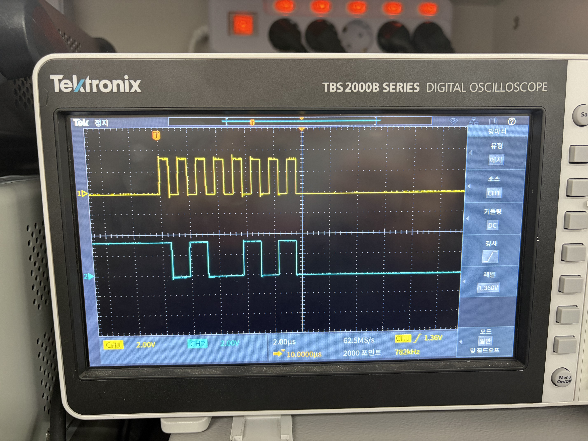
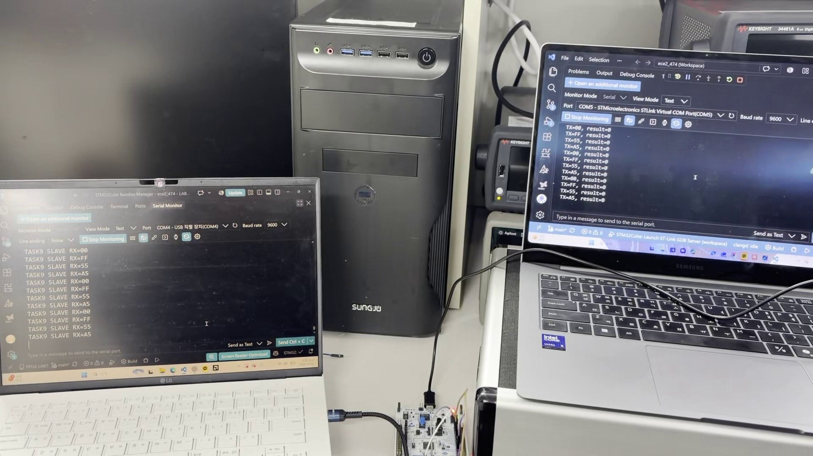
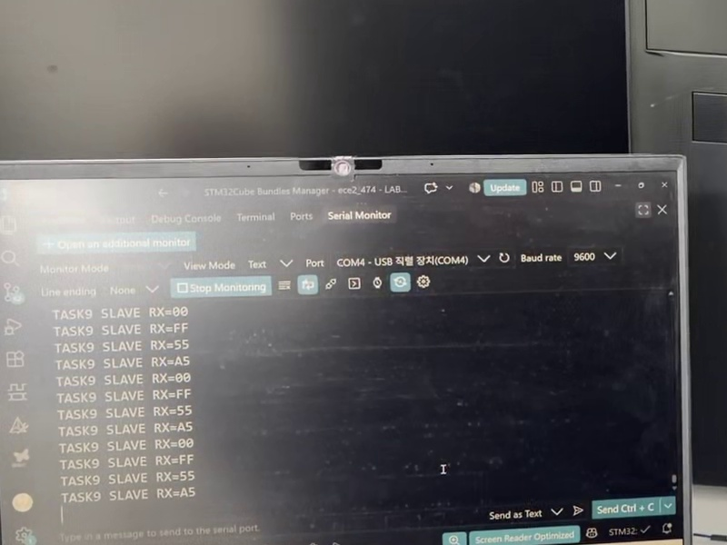
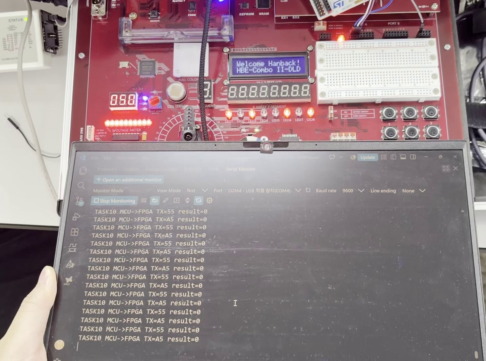
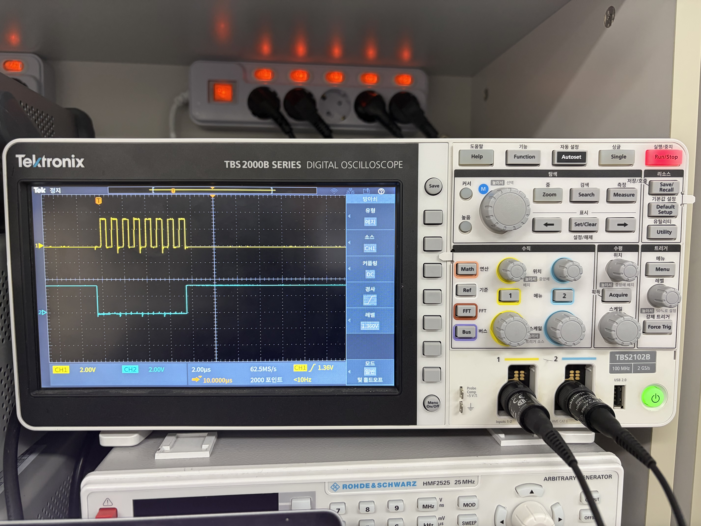
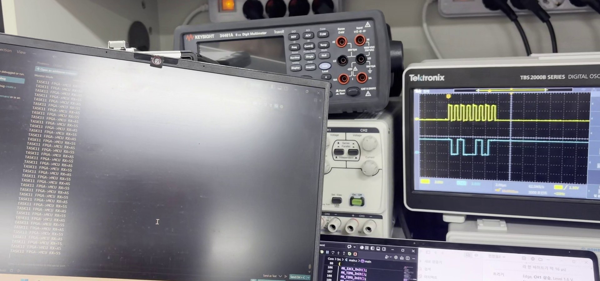
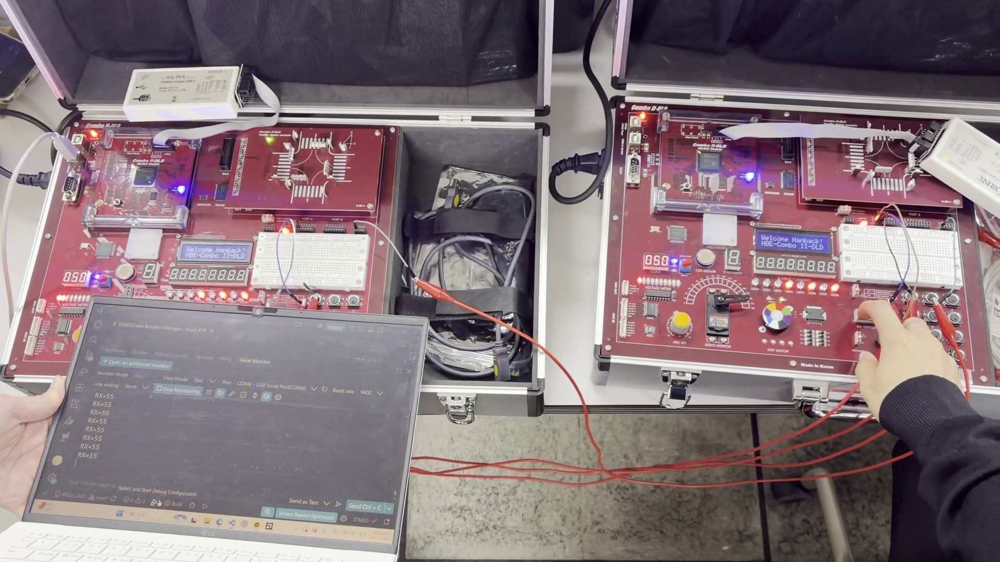
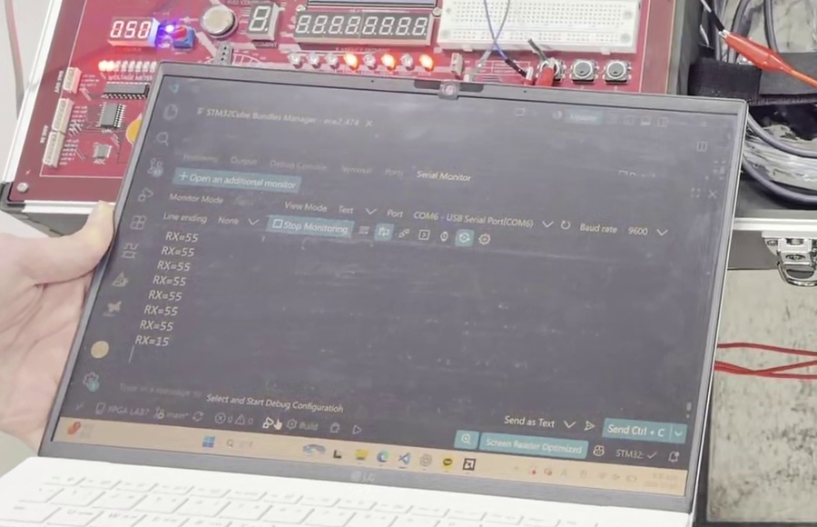

# 실험 후 레포트: STM32_3 과제8~12 (SPI로 MCU와 FPGA 연결)

작성일 2026-11-03. 실험일 2026-11-02. 보드: NUCLEO-G474RE + Combo II-DLD S75(xc7s75fgga484-1), 오실로스코프 Tektronix TBS2102B. 매뉴얼: [Glaysia/ece2_26_2_2 `c/stm32/docs/STM32_3.md`](https://github.com/Glaysia/ece2_26_2_2/blob/main/c/stm32/docs/STM32_3.md)

[실험 전 레포트](../pre/STM32_3_spi.md) · [과제 코드·FPGA 회로·배선](../../evidence/STM32_3/README.md) · [시연 영상](../../evidence/STM32_3/boards/videos) · [사진](../../evidence/STM32_3/boards/photos)

공통 조건: SPI Mode 0(SCK 대기 LOW, 상승 에지 샘플), 8비트, MSB first, MISO 미연결. VCP·FPGA UART는 9600 bps 8N1. 실험은 조원과 함께 진행했으며, 과제9 수신·과제10·과제11은 조원 PC의 코드로 실행해 출력 앞에 `TASKn` 표시가 붙어 있습니다.

## 1. STM32_3_과제8 · MCU 송신 파형

### 코드와 연결
[spi_master_tx/ece2_474_routine.c](../../evidence/STM32_3/VScode/spi_master_tx/ece2_474_routine.c)

- 1초마다 0x55 → 0xA5 → 0x00 → 0xFF를 `HAL_SPI_Transmit(&hspi1, &tx, 1U, 100U)`로 보내고, 전송 앞뒤로 CS(PB6)를 LOW/HIGH로 바꿉니다.
- 오실로스코프: CH1 = SCK(PB3), CH2 = MOSI(PA7), 2 V/div, 2 µs/div, 트리거 CH1 상승 1.36 V, 일반(Normal) 모드.

### 보드 결과
[과제8 시연 영상](../../evidence/STM32_3/boards/videos/task8_demo.mp4)

| 송신값 | 사진 | 상승 에지 8개에서 읽은 MOSI | 판정 |
|---|---|---|---|
| 0x55 | [task8_0x55](../../evidence/STM32_3/boards/photos/task8_0x55.jpg) | 0 1 0 1 0 1 0 1 | 일치 |
| 0xA5 | [task8_0xA5](../../evidence/STM32_3/boards/photos/task8_0xA5.jpg) | 1 0 1 0 0 1 0 1 | 일치 |
| 0x00 | [task8_0x00](../../evidence/STM32_3/boards/photos/task8_0x00.jpg) | 전부 LOW | 일치 |
| 0xFF | [task8_0xFF](../../evidence/STM32_3/boards/photos/task8_0xFF.jpg) | 전부 HIGH | 일치 |

- SCK는 대기 중 LOW이고 한 바이트에 상승 에지가 정확히 8번 나왔습니다(CPOL 0).
- 오실로스코프의 트리거 주파수 표시가 **782 kHz**였고, 첫 상승 에지부터 8번째 상승 에지까지가 화면에서 약 4.5칸(≈ 9 µs, 7주기)이어서 주기 ≈ 1.28 µs로 계산값 100 MHz / 128 = 781.25 kHz와 일치합니다.
- MOSI는 SCK 하강 에지에서 바뀌고 SCK가 HIGH인 동안 안정되어 있었습니다(CPHA 0).
- 전송이 끝난 뒤(CS HIGH 구간) MOSI 레벨은 바이트마다 HIGH 또는 LOW로 남았는데(예: 0x00 뒤 HIGH, 0xFF 뒤 LOW), 수신 측은 CS LOW 동안의 상승 에지 값만 읽으므로 데이터에 영향이 없습니다.

## 2. STM32_3_과제9 · MCU → MCU

### 연결
송신 보드(마스터 코드) PB3·PA7·PB6 → 수신 보드 PB3·PA7·**PA4(NSS)**, GND 공통. 수신 보드는 SPI1을 `SPI_MODE_SLAVE`, `SPI_NSS_HARD_INPUT`으로 다시 초기화합니다.

### 보드 결과
[과제9 시연 영상](../../evidence/STM32_3/boards/videos/task9_demo.mp4)

- 송신 보드 VCP(오른쪽)에 `TX=55, result=0`, `TX=A5, result=0`, `TX=00, result=0`, `TX=FF, result=0`이 1초마다 반복되었습니다.
- 수신 보드 VCP(왼쪽)에 `TASK9 SLAVE RX=55`, `RX=A5`, `RX=00`, `RX=FF`가 같은 순서로 반복되어, 보낸 네 값이 빠짐없이 그대로 도착했습니다.

## 3. STM32_3_과제10 · MCU → FPGA

### 연결
MCU(마스터) PB3 → F8(BDIO_00), PA7 → E8(BDIO_01), PB6 → A7(BDIO_02), GND 공통. FPGA는 SCK·MOSI·CS를 2단 동기화하고 SCK 상승 에지마다 MOSI를 시프트 레지스터에 넣는 수신 회로입니다.

### 보드 결과
[과제10 시연 영상](../../evidence/STM32_3/boards/videos/task10_demo.mp4)

- MCU VCP에 `TASK10 MCU->FPGA TX=55 result=0`과 `TX=A5 result=0`이 번갈아 출력되었습니다.
- FPGA LED1~8이 받은 값을 표시했으며, 영상에서 LED1·3·6·8이 켜진 상태(1010 0101 = 0xA5)와 0x55 상태가 1초마다 번갈아 나타나 MCU 송신값과 일치했습니다.

## 4. STM32_3_과제11 · FPGA → MCU

### 연결
FPGA(마스터) F8 → MCU PB3, E8 → PA7, A7 → **PA4**, GND 공통. MCU는 슬레이브 수신 코드입니다. 매뉴얼대로 오실로스코프로 FPGA 출력 파형을 먼저 확인한 뒤 MCU에 연결했습니다.

### 보드 결과
[MOSI 확인 영상](../../evidence/STM32_3/boards/videos/task11_MOSI_demo.mp4) · [CS 확인 영상](../../evidence/STM32_3/boards/videos/task11_CS_demo.mp4)

- CH1 = SCK, CH2 = CS: CS가 LOW로 내려간 뒤 SCK 상승 에지 8개가 나오고, 마지막 하강 에지 뒤 CS가 HIGH로 돌아갔습니다. 첫 상승 에지 전과 CS 해제 전에 여유 구간이 있어 Mode 0 규칙을 지켰습니다.
- SCK 8개가 화면에서 약 3.5칸(≈ 7 µs, 7주기)에 걸쳐 주기 ≈ 1 µs(약 1 MHz)로, "1 MHz 이하" 조건의 상한에 가까웠습니다. 사전 설계(500 kHz, 반주기 50클록)처럼 여유를 두는 편이 배선 노이즈에 더 안전합니다.
- MCU VCP에 `TASK11 FPGA->MCU RX=55`와 `RX=A5`가 번갈아 출력되어 FPGA 송신값과 일치했습니다.

## 5. STM32_3_과제12 · FPGA → FPGA

### 연결
송신 FPGA의 F8·E8·A7 → 수신 FPGA의 F8·E8·A7(같은 번호끼리), GND 공통. 수신 FPGA는 받은 값을 `RX=xx`로 보드 USB-UART(COM6, 9600)에 출력합니다.

### 보드 결과
[과제12 시연 영상](../../evidence/STM32_3/boards/videos/task12_demo.mp4)

- 송신 DIP를 0101 0101로 둔 동안 수신 PC에 `RX=55`가 1초마다 반복되었고, 영상 중 DIP를 바꾸자 출력이 `RX=15`(0001 0101)로 바뀌었습니다. 송신 측 DIP 값이 그대로 수신 FPGA의 UART 출력으로 나타났습니다.

## 6. 결론

| 과제 | 경로 | 확인 방법 | 결과 |
|---|---|---|---|
| 8 | MCU 송신 | 오실로스코프 SCK·MOSI | 55·A5·00·FF 비트 순서 일치, SCK 782 kHz |
| 9 | MCU → MCU | 두 VCP | RX = TX (55, A5, 00, FF) |
| 10 | MCU → FPGA | MCU VCP + FPGA LED | LED = TX (55, A5) |
| 11 | FPGA → MCU | 오실로스코프 SCK·CS + MCU VCP | RX = 55, A5, SCK ≈ 1 MHz |
| 12 | FPGA → FPGA | 수신 FPGA UART | RX = 송신 DIP (55, 15) |

SPI는 마스터가 SCK와 CS를 만들고 수신 측이 SCK 상승 에지에서 MOSI를 읽는 동기식 통신이라, UART처럼 속도를 미리 맞추지 않아도 MCU(781 kHz)와 FPGA(약 1 MHz) 마스터 모두에서 같은 슬레이브가 정상 수신했습니다. 오실로스코프로 Mode 0(대기 LOW, 하강 에지 변경, 상승 에지 샘플), MSB first, CS 구간을 직접 확인했고, MCU 슬레이브의 CS 입력이 PB6가 아니라 PA4(NSS)라는 점과 두 보드 사이 GND 공통 연결이 정상 동작의 조건이었습니다.
