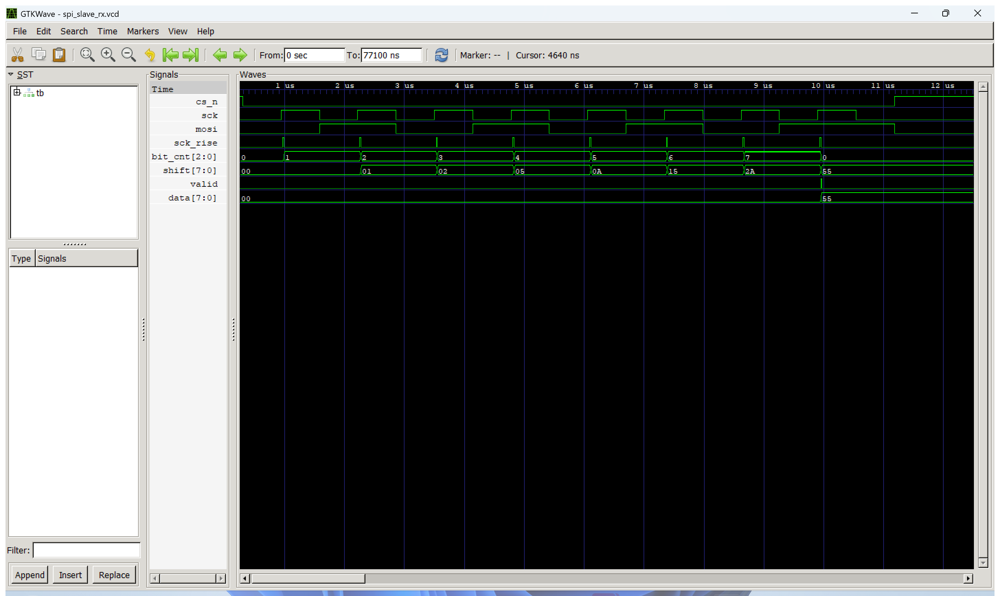
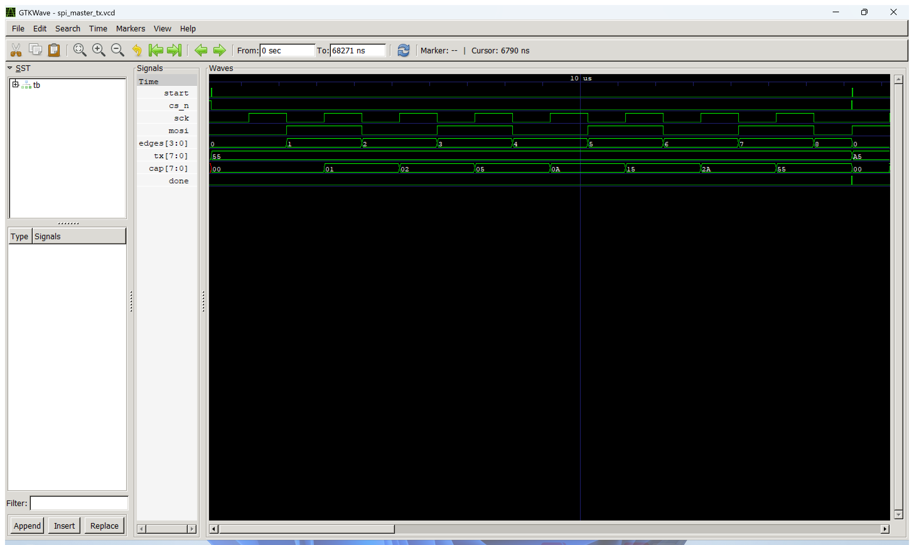

# 실험 전 레포트: STM32_3 SPI로 MCU와 FPGA 연결 (과제8~12)

작성일 2026-11-01. 실험일 2026-11-02. 매뉴얼: [Glaysia/ece2_26_2_2 `c/stm32/docs/STM32_3.md`](https://github.com/Glaysia/ece2_26_2_2/blob/main/c/stm32/docs/STM32_3.md)

[실험 준비 자료와 배선](../../evidence/STM32_3/README.md)

## 1. 목적과 핵심 파라미터 계산

### 실험 목적
SPI(Serial Peripheral Interface)로 MCU와 FPGA 사이에 한 바이트씩 데이터를 보낸다. MCU는 HAL의 SPI1 하드웨어로 마스터 송신·슬레이브 수신을 하고, FPGA는 SPI 수신 회로(과제10)와 송신 회로(과제11)를 Verilog로 직접 작성한다. 받은 값은 MCU VCP UART 또는 FPGA UART로 PC에 출력해 송신값과 비교한다. 이번 주차는 교재 FPGA 실습 없이 SPI 과제8~12에 집중한다.

### SPI Mode 0 규칙 (이번 실습 공통)
- 마스터가 SCK를 만들고, CS(LOW 활성)가 LOW인 동안만 통신한다.
- **CPOL = 0**: SCK는 대기 상태에서 LOW. **CPHA = 0**: 수신 측은 SCK **상승 에지**에서 MOSI를 읽고, 송신 측은 첫 비트를 첫 상승 에지 **전에** 준비한 뒤 **하강 에지**에서 다음 비트로 바꾼다.
- 8비트, **MSB first**: 0x55 = `0 1 0 1 0 1 0 1`, 0xA5 = `1 0 1 0 0 1 0 1` 순서로 MOSI에 나간다. 한 바이트에 상승 에지 8번.
- 이번 과제는 한 방향씩 확인하므로 MISO는 연결하지 않는다. UART와 달리 클록선(SCK)이 있는 **동기식**이라 양쪽이 속도를 미리 약속할 필요가 없고, 수신 측은 마스터의 SCK에 맞춰 읽는다.

### 핵심 파라미터 계산
1. **MCU SCK (템플릿 SPI1 설정)**:
   $$f_{\mathrm{SCK}} = \frac{100\text{ MHz}}{\text{BaudRatePrescaler}=128} = 781.25\text{ kHz},\qquad T = 1.28\ \mu\text{s}$$
   한 바이트 전송 시간은 약 $8 \times 1.28 = 10.24\ \mu$s이다. 설정: `SPI_MODE_MASTER`, `SPI_POLARITY_LOW`, `SPI_PHASE_1EDGE`, `SPI_DATASIZE_8BIT`, `SPI_FIRSTBIT_MSB`, `SPI_NSS_SOFT`(CS는 PB6 GPIO로 직접 제어).

2. **FPGA SCK (spi_master_tx, 1 MHz 이하 조건)**:
   $$f_{\mathrm{SCK}} = \frac{f_{\mathrm{clk}}}{2 \times \text{HALF\_CYCLES}} = \frac{50\text{ MHz}}{2 \times 50} = 500\text{ kHz},\qquad T = 2\ \mu\text{s}$$
   HALF_CYCLES를 25 미만(1 MHz 초과)으로 바꾸면 테스트벤치가 실패하도록 했다.

3. **FPGA 수신 샘플링 여유 (spi_slave_rx)**:
   - SCK·MOSI·CS를 50 MHz(20 ns)로 2단 동기화하므로 에지 검출은 실제보다 2~3클록(40~60 ns) 늦다.
   - MCU SCK 반주기는 640 ns이므로, 상승 에지 검출 시점의 MOSI(같은 2단 지연을 거친 값)는 다음 하강 에지까지 충분히 안정되어 있다. 반주기 640 ns ≫ 동기화 지연 60 ns.
   - 50 MHz로 SCK를 샘플링하려면 SCK 반주기가 클록 주기의 수 배 이상이어야 한다. 781 kHz SCK의 반주기는 클록 32개에 해당한다.

4. **FPGA UART 출력 (과제10·12)**: 9600 8N1, 분주 $\lfloor(50{,}000{,}000 + 4{,}800)/9{,}600\rfloor = 5{,}208$클록. `RX=55\r\n` 7문자 = 70비트 ≈ 7.3 ms로, 1초마다 오는 한 바이트를 충분히 출력한다.

---

## 2. 파일 구성과 역할

| 경로 | 파일명 | 역할 및 설명 |
|---|---|---|
| `evidence/STM32_3/VScode/spi_master_tx/` | `ece2_474_routine.c` | MCU 마스터: 1초마다 0x55 → 0xA5 → 0x00 → 0xFF를 `HAL_SPI_Transmit`으로 송신, CS(PB6)를 전송 전후 LOW/HIGH, `TX=xx, result=n` 출력 |
| `evidence/STM32_3/VScode/spi_slave_rx/` | `ece2_474_routine.c` | MCU 슬레이브(제공 코드): `ece2_474_init()`에서 SPI1을 `SPI_MODE_SLAVE`, `SPI_NSS_HARD_INPUT`으로 재설정, PA4를 NSS(AF5)로, `HAL_SPI_Receive` 2초 대기 후 `RX=xx` 또는 timeout 출력 |
| `evidence/STM32_3/VScode/` | `use_task.ps1`, `build_check.txt` | 코드 교체 스크립트, 빌드 확인(두 코드 모두 경고 0) |
| `evidence/STM32_3/FPGA/src/` | `spi_slave_rx.v` | FPGA SPI 수신: 2단 동기화, SCK 상승 에지 검출, MSB first 시프트 레지스터, 3비트 카운터, 8비트 완료 시 `valid` 1클록, CS 해제 시 카운터 초기화 |
| `evidence/STM32_3/FPGA/src/` | `spi_rx_uart.v` | 과제10·12 수신 FPGA 최상위: 받은 값을 `RX=xx\r\n`으로 UART 출력, LED 표시 |
| `evidence/STM32_3/FPGA/src/` | `spi_master_tx.v` | FPGA SPI 송신: `start`에 CS LOW + MSB 준비, SCK 500 kHz, 하강 에지마다 다음 비트, 8번째 하강 후 반주기 뒤 CS HIGH와 `done` |
| `evidence/STM32_3/FPGA/src/` | `spi_tx_top.v` | 과제11·12 송신 FPGA 최상위: 1초 tick마다 DIP1~8 값을 송신, LED 표시 |
| `evidence/STM32_3/FPGA/src/` | `uart.v` | Lab3 UART 에코의 `uart_tx`(·`uart_rx`) 재사용 |
| `evidence/STM32_3/FPGA/sim/` | `tb_spi_slave_rx.sv` | MCU 마스터 모델(781 kHz)로 0x55·0xA5·0x00·0xFF, 5비트만 보내고 CS 해제(무시), 다음 바이트 0x3C 수신 검사 |
| `evidence/STM32_3/FPGA/sim/` | `tb_spi_master_tx.sv` | 독립 Mode 0 검사기: SCK LOW 대기, CS 밖 에지 금지, 상승 에지 8번, SCK HIGH 동안 MOSI 변화 금지, MOSI 셋업, SCK ≤ 1 MHz |
| `evidence/STM32_3/FPGA/sim/` | `tb_spi_loop.sv` | 송신 FPGA → 수신 FPGA → UART `RX=55/A5/00/FF` 문자열까지 확인 (과제12) |
| `evidence/STM32_3/FPGA/constraints/` | `spi_rx_uart.xdc`, `spi_tx_top.xdc` | BDIO_00/01/02 = F8/E8/A7(SCK/MOSI/CS), UART TX F6, DIP·LED·클록·리셋 |
| `evidence/STM32_3/FPGA/` | `build_vivado.tcl`, `capture_wave.ps1` | Vivado 시뮬레이션·비트스트림 생성, GTKWave 캡처 |

---

## 3. 테스트벤치 자극과 기대 결과

### FPGA 수신 (`tb_spi_slave_rx`, 50 MHz 클록, SCK 781.25 kHz 모델)

| 검사 | 인가 자극 | 기대 결과 | 의미 |
|:---:|---|---|---|
| 1~4 | CS LOW → MSB 준비 → SCK 8주기 → CS HIGH, 값 0x55·0xA5·0x00·0xFF | 바이트마다 `valid` 한 번, `data` = 보낸 값 | 비트 순서와 상승 에지 샘플링 |
| 5 | 0xC3의 앞 5비트만 보내고 CS HIGH | `valid` 없음, `data`는 이전 값(FF) 유지 | 불완전 바이트 무시 |
| 6 | 이어서 0x3C 전체 | `data` = 3C | CS 해제 후 다음 바이트를 처음부터 수신 |

### FPGA 송신 (`tb_spi_master_tx`, HALF_CYCLES = 50)

| 검사 | 기대 결과 | 의미 |
|:---:|---|---|
| CS 하강 시 | SCK = 0 | CPOL 0 대기 |
| 매 상승 에지 | CS = 0, MOSI가 20 ns 이상 안정 | CS 밖 에지 없음, 셋업 |
| SCK HIGH 동안 | MOSI 변화 없음 | 하강 에지에서만 비트 변경 (CPHA 0) |
| 한 바이트 | 상승 에지 8번, 모은 비트 = 보낸 값 (55, A5, 00, FF) | MSB first |
| 주기 | ≥ 1000 ns (측정 2000 ns = 500 kHz) | 1 MHz 이하 |

### FPGA → FPGA → UART (`tb_spi_loop`, 축소: 1초 = 2,000클록, UART DIV = 8, SCK HALF = 4)
송신 측 DIP 값을 55 → A5 → 00 → FF로 바꾸며, 수신 측 UART에서 `R`, `X`, `=`, 상위 hex, 하위 hex, `\r`, `\n` 7문자와 수신 LED 값을 검사한다.

---

## 4. 시뮬레이션 결과 및 수정 실험

실행 환경: Icarus Verilog 12.0, GTKWave, Vivado 2026.1, GNU Tools for STM32 14.3.1.

| 대상 | 결과 | 종료 시각 |
|---|---|---|
| MCU 마스터·슬레이브 코드 빌드 | [경고 0, FLASH 28,896 B / 30,736 B](../../evidence/STM32_3/VScode/build_check.txt) | |
| FPGA 수신 | [`PASS SPI_SLAVE_RX: 55 A5 00 FF, partial byte dropped, next byte 3C`](../../evidence/STM32_3/VScode/spi_slave_rx_sim_log.txt) | 77,100 ns |
| FPGA 송신 | [`PASS SPI_MASTER_TX: Mode0, 8 rising edges, MSB first, SCK 500 kHz`](../../evidence/STM32_3/VScode/spi_master_tx_sim_log.txt) | 68,271 ns |
| FPGA → FPGA → UART | [`PASS SPI_LOOP: FPGA master -> FPGA slave -> UART RX=55 A5 00 FF`](../../evidence/STM32_3/VScode/spi_loop_sim_log.txt) | 172,790 ns |
| Vivado XSim (`tb_spi_loop`) | 같은 PASS 메시지 | |

### Vivado 구현 결과 (xc7s75fgga484-1, 50 MHz)

| 최상위 | WNS | WHS | LUT | FF | 오류/치명 경고 | 비트스트림 |
|---|---|---|---|---|---|---|
| `spi_rx_uart` (과제10·12 수신) | 14.631 ns | 0.122 ns | 87 | 99 | 0 / 0 | [`spi_rx_uart.bit`](../../evidence/STM32_3/vivado/spi_rx_uart.bit) |
| `spi_tx_top` (과제11·12 송신) | 14.309 ns | 0.219 ns | 70 | 88 | 0 / 0 | [`spi_tx_top.bit`](../../evidence/STM32_3/vivado/spi_tx_top.bit) |

두 설계 모두 20 ns 클록 제약을 여유 있게 만족한다. 비트스트림은 실험실에서 Open Hardware Manager → Program Device로 바로 올린다. [빌드 요약](../../evidence/STM32_3/vivado/build_summary.txt)

### 파형 해석 – FPGA 수신

- `cs_n`이 LOW가 된 뒤 `sck`가 8번 올라가고, 그때마다 `sck_rise`(동기화 후 검출된 상승 에지)가 한 클록 1이 된다.
- `bit_cnt`가 1 → 7 → 0으로 늘고, `shift`가 01 → 02 → 05 → 0A → 15 → 2A → 55로 쌓인다. 0x55의 비트 `0 1 0 1 0 1 0 1`이 MSB부터 들어온 결과다.
- 8번째 상승 에지에서 `valid`가 한 클록 1이 되고 `data` = 55가 된다. 이어서 `cs_n`이 HIGH가 되어 다음 바이트를 준비한다.

### 파형 해석 – FPGA 송신

- `start` 직후 `cs_n`이 LOW가 되고, 첫 상승 에지 전에 `mosi`에 MSB(0)가 준비된다. `sck`는 2 µs 주기(500 kHz)로 8번 상승한다.
- `mosi`는 `sck` 하강 에지에서만 바뀌고(`edges` 1 → 8), 검사기가 상승 에지마다 모은 `cap`이 01 → … → 55가 되어 보낸 값과 같다. 끝나면 `cs_n` HIGH, `done` 한 클록.

### 파형 해석 – FPGA → FPGA → UART

- 송신 측 `sw`가 55 → A5 → 00 → FF로 바뀔 때마다 1초(축소) tick에 맞춰 `cs_n`이 내려가며 한 바이트가 전송되고, 수신 측 `rx_valid` 직후 `rx_data`·`led_rx`가 같은 값이 된다. 이어서 `txd`로 `RX=xx` 7문자가 나간다.

### 수정 실험 (오류 주입 및 복구)

| 실험 | 변경 | 결과 | 의미 |
|---|---|---|---|
| 수신 1 | SCK **하강** 에지에서 샘플 | `FATAL: sent 55 received ab` | Mode 0은 상승 에지 샘플이어야 함. 한 비트씩 밀려 받음 |
| 수신 2 | CS HIGH일 때 비트 카운터 초기화 삭제 | `FATAL: sent 3c received c1` | 불완전 바이트 뒤 다음 바이트가 어긋남 → CS 해제 시 초기화 필요 |
| 수신 3 | LSB first로 시프트 | `FATAL: sent 55 received aa` | 비트 순서가 뒤집힘 |
| 송신 1 | SCK **상승** 에지에서 MOSI 변경 | `FATAL: MOSI changed while SCK high` | 수신 측이 읽는 순간 데이터가 바뀜 |
| 송신 2 | HALF_CYCLES = 20 (1.25 MHz) | `FATAL: SCK period 800 ns < 1000 ns` | 1 MHz 이하 조건 검사 |
| 원복 | 원래 코드 | 세 TB 모두 PASS | 정상 |

---

## 5. 보드 실험 계획 및 관찰 항목

### 배선 (GND 공통, 3.3 V, 전원 끈 상태에서 연결)

| 신호 | MCU 마스터 | MCU 슬레이브 | FPGA |
|---|---|---|---|
| SCK | PB3 | PB3 | BDIO_00 (F8) |
| MOSI | PA7 | PA7 | BDIO_01 (E8) |
| CS | PB6 | PA4 (NSS) | BDIO_02 (A7) |

### 절차
1. **과제8**: MCU 마스터 코드 실행. 오실로스코프 CH1 SCK(PB3), CH2 MOSI(PA7)(가능하면 CH3 CS(PB6)), 트리거 CS 하강. CS LOW 구간, SCK LOW 대기, 상승 에지 8번, 0x55·0xA5·0x00·0xFF 비트 순서, SCK 주기 1.28 µs(781 kHz)를 기록한다.
2. **과제9**: 지정 조와 MCU 두 대 연결. 수신 측(slave 코드)을 먼저 실행해 timeout을 확인한 뒤 송신 측 실행. 수신 VCP `RX=` 값이 송신 VCP `TX=` 값과 같은지 확인하고, CS 배선(새 마스터 PB6 → 새 슬레이브 PA4)까지 바꿔 역할을 교대한다.
3. **과제10**: 자기 조 MCU(마스터) → FPGA(`spi_rx_uart.bit`). FPGA USB-UART COM 포트에 `RX=55` …가 MCU의 `TX=` 순서와 같은지, LED에 같은 값이 보이는지 확인한다.
4. **과제11**: FPGA(`spi_tx_top.bit`)를 마스터로, DIP1~8로 값 설정. 먼저 오실로스코프로 F8·E8·A7 파형(SCK 2 µs 주기, 1초마다 한 바이트)을 확인하고, MCU slave 코드의 VCP `RX=`가 DIP 값과 같은지 확인한다.
5. **과제12**: 지정 조와 FPGA 두 대 연결(송신 `spi_tx_top.bit` → 수신 `spi_rx_uart.bit`, 같은 BDIO 번호끼리). 수신 FPGA UART 출력이 송신 DIP 값과 같은지 확인하고 역할을 교대한다.
6. 각 단계의 오실로스코프 화면, 두 COM 포트 출력, 배선 사진을 기록한다.
